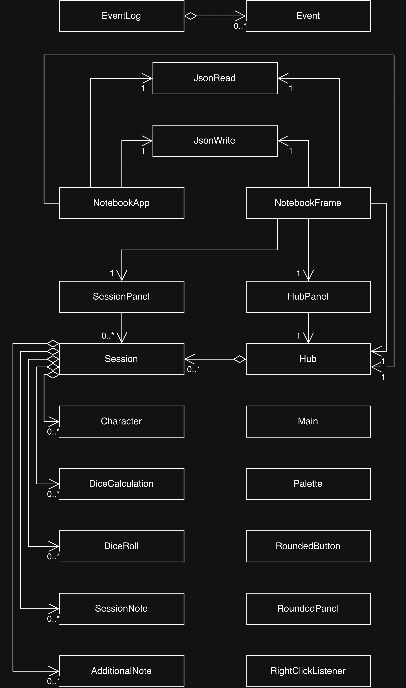

# DnD Player Notebook

When I started playing DnD, I didn't realize how cumbersome, time-consuming, and messy the traditional character sheet was. By the end of my first campaign, the character sheet was covered in pencil marks and smudges. That was when I realized how convenient an online character sheet could be, and that served as the inspiration for this project.

This is a tool made by players, for players, and hope to be the most supportive to players. 

## Applications

The DnD Player Notebook serves as an all-in-one player toolkit containing all the essential functionalities a player might need, such as:
- Character sheets & relevent info *(based on the official WotC character sheet)*
- Digital dice roller and roll calculator
- Session notes
- Configurable area for additional notes

**Everything** that this application offers is customizable to allow for homebrews and special conditions.


## User Stories

- As a user, I want to be able to add a character to a session, specifying a name, level, and stats
- As a user, I want to be able to add a dice calculation to a session, specifying dice included and lowest, average, and highest results
- As a user, I want to be able to add a dice roll to a session, specifying dice type, number and rolling to get a result
- As a user, I want to be able to add a session note to a session, specifying a title and text content
- As a user, I want to be able to add an additional note to a session, specifying a title and text content
- As a user, I want to be able to add a session to the list of sessions, specifying a name

- As a user, I want to be able to view all characters added to a session, showing each character's name, level, and stats
- As a user, I want to be able to view all dice calculations added to a session, showing die types and results
- As a user, I want to be able to view all dice rolls added to a session, showing each roll's die type and result
- As a user, I want to be able to view all session notes added to a session, showing each note's title and text content
- As a user, I want to be able to view all additional notes added to a session, showing each note's title and text content
- As a user, I want to be able to view all sessions in the hub of the application, showing each session's name

- As a user, I want to be able to view and edit any existing character added to a session, including their name, level, and stats
- As a user, I want to be able to view and edit any existing dice calculation added to a session, including its die types and result
- As a user, I want to be able to view and edit any existing dice roll added to a session
- As a user, I want to be able to view and edit any existing session note added to a session, including its title and text content
- As a user, I want to be able to view and edit any existing additional note added to a session, including its title and text content
- As a user, I want to be able to view and edit any existing session added to the list of sessions, including its name

- As a user, I want to be able to remove a character from a session
- As a user, I want to be able to remove a dice roll from a session
- As a user, I want to be able to remove a session note from a session
- As a user, I want to be able to remove an additional note from a session
- As a user, I want to be able to remove a session from the list of sessions

- As a user, I want to be able to select a character from the hub and be taken directly to the session that character belongs to
- As a user, I want to be able to pin a session as my currently active session for quick access from the hub

- As a user, I want to be able to save the entire state of my hub, including all sessions and the characters, dice rolls, dice calculations, session notes, and additional notes associated with each session, to file automatically closing the application, and also be able to manually save whenever I choose to.
- As a user, I want to be able to load the entire state of my hub, including all sessions and the characters, dice rolls, dice calculations, session notes, and additional notes associated with each session, in the exact state that I left it as, from file automatically, and also be able to manually load whenever I choose to.

## Instructions for End User

- You can view the panel that displays the Sessions that have already been added to the Hub by launching the application. The Hub panel displays three columns, with every session listed in the middle "Sessions" column.
- You can generate the first required action related to the user story "adding multiple Sessions to a Hub" by typing a session name into the text field at the bottom of the Sessions column and clicking the "add" button.
- You can generate the second required action related to the user story "adding multiple Sessions to a Hub" by right-clicking any session card and selecting "Pin". Pinned sessions are then shown as a filtered subset in the "Pinned Sessions" column, and their characters are listed first in the "Characters" column. Right-clicking also offers "Rename" and "Delete".
- You can locate my visual component by looking at the top of the Hub screen. There is an image displayed as the title.
- You can save the state of my application by selecting File > Save from the menu bar. The application also saves automatically when the window is closed, and a few seconds after any edit.
- You can reload the state of my application by selecting File > Load from the menu bar. The application also loads automatically on startup.

## Phase 4: Task 2

Representative sample of events logged during a run of the application:

```
Sun Aug 09 16:28:20 PDT 2026
Session Dragon Lance added to hub

Sun Aug 09 16:28:22 PDT 2026
Session Dragon Lance pinned

Sun Aug 09 16:28:24 PDT 2026
Session Dragon Lance unpinned

Sun Aug 09 16:28:25 PDT 2026
Character Steve added to Session Dragon Lance

Sun Aug 09 16:28:29 PDT 2026
Dice Roll 3 added to Session Dragon Lance

Sun Aug 09 16:28:40 PDT 2026
Dice Calculation Possible Stats From Rolling added to Session Dragon Lance

Sun Aug 09 16:29:23 PDT 2026
Session Note Session 0 added to Session Dragon Lance

Sun Aug 09 16:29:39 PDT 2026
Additional Note Companion Stat Block added to Session Dragon Lance

Sun Aug 09 16:29:51 PDT 2026
Character Steve removed from Session Dragon Lance

Sun Aug 09 16:29:52 PDT 2026
Character Steven added to Session Dragon Lance

Sun Aug 09 16:29:59 PDT 2026
Session Dragon Lance deleted from hub
```

## Phase 4: Task 3


The diagram is centered around Hub and Session, with all other classes from the model package branching off of them. Every association within the model package is an aggregation, meaning the model is built entirely on containment. The classes in the ui package hold plain references rather than aggregating anything. Due to most of the classes in the ui package being helper classes, they aren't considered as associations with the rest of the classes, leaving them without arrows. 

# Reflection
If I had more time, there are several refactorings I would apply. A parent type could have been created for the different components of a session (Character, DiceRoll, etc), which would make Session far more concise and remove much of the repeated code in both the model and the ui. Exceptions could have been used to signal unwanted results, such as missing id for a component, rather than handling every case with if and else statements, and some of the more conditional logic, such as pinning and unpinning, could have been moved into the ui classes to reduce coupling.

Subclasses of the panels could also have been created, since SessionPanel has grown large enough that it handles navigation, item listing, and form building all at once. Most importantly, given more time I would have completed the remaining functionality of the application, as several user stories are supported by the model but are not yet reachable through the GUI.


